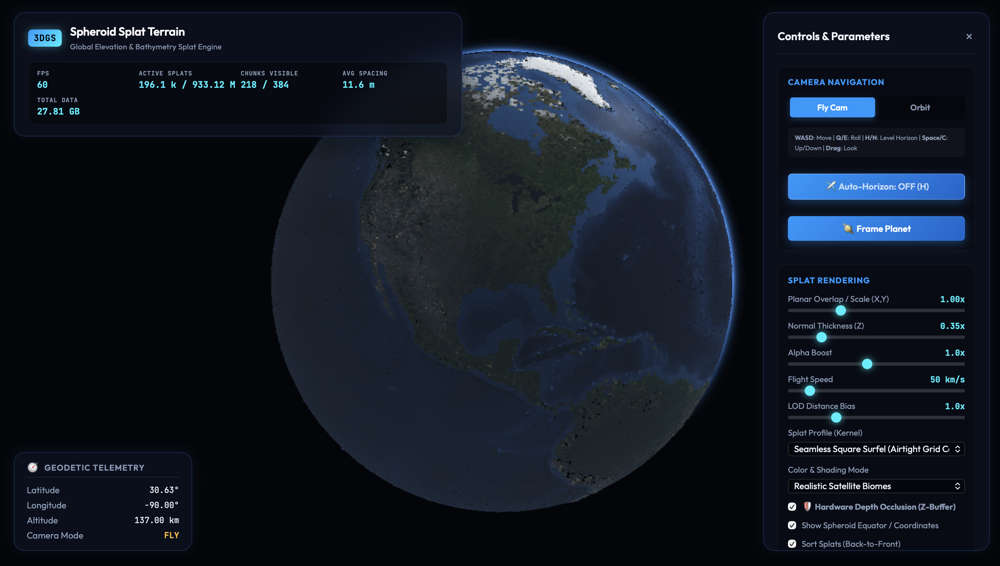

# 🌍 splat-earth

> **A research spike investigating geometry-less 3D Gaussian Splatting for planetary-scale terrain on oblate spheroids (WGS-84), and why we pivoted to oriented surface surfels.**



---

## 📖 The "What-If" & The Pivot

This project started as an experimental exploration: **Can geometry-less 3D Gaussian Splats replace traditional polygon meshes and heightmap tiles for planetary-scale GIS terrain?**

### The Planetary Reality Check
While Gaussian Splatting produces photorealistic novel-view synthesis for contained scenes, scaling it to planetary bodies (from 1,000 km orbital altitude down to 10-meter ground level) highlighted two fundamental roadblocks:

1. **Astronomical Data Scale**: Representing an entire planetary spheroid across macroscopic and microscopic scales requires billions of Gaussian points. Without extreme hierarchical spatial partitioning, memory and network payloads quickly become prohibitive.
2. **Near-Field Transparency Breakdown**: Traditional 3D Gaussians are semi-transparent volumetric ellipsoids that require continuous back-to-front sorting along the camera ray. When the camera flies close to large, coarse splats, their semi-transparency causes the surface to appear as a fuzzy, translucent cloud rather than solid ground.

### The Solution: Oriented Surface Splats (Surfels)
To eliminate these artifacts while preserving the geometry-less point-cloud pipeline, the engine pivoted to **normal-aligned surface surfels**:
- **Tangent Disc Alignment**: Elliptical splats are aligned tangentially to the curved WGS-84 oblate spheroid surface using normal-aligned quaternions and local terrain elevation gradients.
- **Hardware Depth Occlusion (Z-Buffer)**: By rendering terrain surfels with hardware depth-buffer writes, opaque ground remains solid and gapless up close—completely eliminating the need for expensive per-frame CPU radix sorting.
- **Two-Pass Water Rendering**: Deep ocean trenches and continental shelves render in Pass 1 (opaque depth write), while the translucent sea surface renders in Pass 2 (depth write disabled with edge feathering) to eliminate seam artifacts.
- **Hierarchical Cubed-Sphere Streaming**: Planetary terrain is partitioned into 384 cubed-sphere spatial chunks across 5 discrete LOD levels, dynamically streaming binary splat chunks into GPU VBOs based on Euclidean distance, gaze alignment, and planetary horizon culling.

---

## 🌟 Key Capabilities

- **Oblate Spheroid Geodesy (`pkg/spheroid`)**:
  - Full WGS-84 reference ellipsoid ($a = 6,378.137\text{ km}$, $f = 1/298.257$).
  - High-precision Geodetic $(\text{lat}, \text{lon}, h) \leftrightarrow \text{ECEF } (X, Y, Z)$ coordinate transformations using Bowring's method.
  - Tangent East-North-Up (ENU) coordinate frames and rotation quaternions.
- **Data-Driven DEM Topography Engine (`pkg/terrain`)**:
  - Auto-discovers and composites multi-resolution elevation rasters, satellite GeoTIFFs, and LiDAR DEMs.
  - Cubed-sphere quadtree tiling that avoids polar coordinate singularity distortions.
  - Steered high-density focus zones (up to 128x density over areas of interest with smooth trigonometric boundary blending).
- **Compact 32-Byte Binary Splat Format (`pkg/splat`)**:
  - Standard 32-byte layout: Position $(3 \times f32)$, Scale $(3 \times f32)$, RGBA $(4 \times u8)$, Quaternion $(4 \times u8)$.
  - Multi-LOD chunk container format with zero-copy binary streaming.
- **Interactive 6-DOF WebGL 2.0 Viewer (`pkg/viewer`, `cmd/viewer`)**:
  - 60+ FPS rendering of hundreds of millions of virtual splats.
  - 6-DOF Fly Camera with planetary horizon auto-leveling + Orbit Camera.
  - Real-time geodetic telemetry HUD (Lat, Lon, Altitude, Active Splats, Visible Chunks).

---

## 🗺️ Obtaining Input Datasets

The terrain generator features an automatic GeoData Catalog (`pkg/terrain/catalog.go`) that scans the `images/` directory at startup, reads GeoTIFF geokeys, bounding boxes, and projections, and blends the highest-resolution layers available.

Create an `images/` folder in the project root:
```bash
mkdir -p images
```

> **Note**: The `images/` and `splats/` folders are excluded from git via `.gitignore` to prevent committing massive multi-gigabyte rasters.

### 1. Wikimedia Global Elevation Map (Quickest Fallback)
A single 21,600 × 10,800 equirectangular grayscale elevation raster (~75 MB) covering the entire globe (~1.85 km per pixel at the equator).

- **Download**: [Wikimedia Commons - World Elevation Map](https://commons.wikimedia.org/wiki/File:World_elevation_map.png)
- **Direct Image Link**: Click "Original file" (21,600 × 10,800 pixels) on the Wikimedia page.
- **Destination**: Save directly as `images/World_elevation_map.png`.

### 2. NASA Blue Marble: Next Generation (500m Global Satellite Imagery)
True-color satellite photography and global topography/bathymetry at 500 meters per pixel ($86,400 \times 43,200$ global pixels).

- **Overview**: [NASA Earth Observatory - Blue Marble: Next Generation](https://science.nasa.gov/earth/earth-observatory/blue-marble-next-generation/)
- **Data Archive**: [Visible Earth - Blue Marble 500m Topography & Bathymetry](https://visibleearth.nasa.gov/images/73934/august-blue-marble-next-generation-w-topography-and-bathymetry)
- **Tiles**: 8 quadrant GeoTIFF files (`A1`, `A2`, `B1`, `B2`, `C1`, `C2`, `D1`, `D2`), e.g.:
  - `world.topo.bathy.200408.3x21600x21600.A1_geo.tif`
  - `world.topo.bathy.200408.3x21600x21600.A2_geo.tif`
  - ... through `D2_geo.tif`
- **Destination**: Drop any or all 8 tiles into `images/`. The generator auto-detects them and applies satellite true-color photorealism to the splats.

### 3. GEBCO Global Ocean Bathymetry & Land Elevation (1km Grid)
High-precision sub-pixel digital elevation models for oceanic trenches (e.g. Mariana Trench) and continental shelf topography.

- **Source**: [GEBCO (General Bathymetric Chart of the Oceans)](https://www.gebco.net/data_and_products/gridded_bathymetry_data/)
- **Tiles**: 8 elevation (`gebco_08_rev_elev_*_grey_geo.tif`) and 8 bathymetry (`gebco_08_rev_bath_*_grey_geo.tif`) GeoTIFFs.
- **Destination**: Place into `images/` for sub-pixel bilinear elevation sampling.

### 4. USGS 3DEP 1-Meter LiDAR DEMs (Ultra-Resolution Focus Zones)
For sub-meter terrain detail over specific cities, parks, or mountain peaks:

- **Source**: [USGS 3DEP LiDAR Explorer](https://apps.nationalmap.gov/lidar-explorer/#/)
- **Destination**: Download floating-point GeoTIFF DEMs (e.g., Rainier, Mount St. Helens, Grand Canyon) and drop them into `images/`. The generator parses their UTM/Geodetic projections and stamps them as high-density focus zones onto the planetary spheroid.

---

## 🚀 Quick Start

### 1. Build the Binaries
Ensure you have [Go](https://go.dev/) (1.22 or newer) installed:

```bash
# Build the terrain generator and viewer server
go build ./cmd/generate
go build ./cmd/viewer
```

### 2. Generate Terrain Splats

#### Option A: Fast Low-Resolution Preview (~5 seconds)
```bash
./generate -res-lat 150 -res-lon 300 -out splats/preview.splat
```

#### Option B: Standard Relief (3.2x Exaggeration, 1.0 km Height Scale)
```bash
./generate -out splats/world.splat
```

#### Option C: True 1:1 Physical Scale (Authentic Earth Curvature)
```bash
./generate -elev-scale 0.311 -out splats/world.splat
```

#### Option D: High-Density Focus Area (e.g., Mount Rainier 64x density)
```bash
./generate -focus-enable -focus-lat 46.852 -focus-lon -121.760 -focus-area 25 -focus-boost 64 -out splats/rainier.splat
```

#### Common Generator Flags:
| Flag | Default | Description |
|---|---|---|
| `-out` | `splats/terrain.splat` | Output path (`.splat` multi-LOD container or `.ply`) |
| `-elev-scale` | `1.0` | Peak elevation scale in km (`1.0` = 3.2x dramatic relief, `0.311` = authentic 1:1) |
| `-radius` | `100.0` | Spheroid equatorial radius $a$ in visualization km |
| `-flattening` | `0.0033528` | WGS-84 standard flattening ratio $f = (a - b) / a$ |
| `-res-lat`, `-res-lon` | `0` (Auto) | Elevation grid resolution (`0` = auto-detect from source rasters) |
| `-overlap` | `1.38` | Splat footprint overlap factor (ensures gapless coverage) |
| `-thickness` | `0.035` | Splat normal thickness ratio (flattens discs along surface) |
| `-raster` | `images/World_elevation_map.png` | Fallback elevation raster path |
| `-biome-config` | `config/biomes.json` | Path to JSON biome hypsometry & color tuning config |

---

### 3. Launch the Interactive 3D Viewer

Start the local streaming server (auto-detects `splats/world.splat` or `splats/terrain.splat`):

```bash
./viewer -port 8080
```

Open your browser to [http://localhost:8080](http://localhost:8080).

#### Navigation & Controls:
- **Fly Camera Mode**:
  - `W` / `S`: Move Forward / Backward
  - `A` / `D`: Strafe Left / Right
  - `Q` / `E`: Roll Left / Right (6-DOF, gimbal-lock free)
  - `Space` / `C`: Climb Up / Dive Down
  - `H`: Toggle Auto-Horizon (locks camera up-vector to local spheroid surface normal)
  - `Mouse Drag`: Pitch & Yaw free look
  - `Mouse Wheel`: Adjust flight speed
- **Orbit Camera Mode**:
  - `Left Click + Drag`: Orbit around planetary body
  - `Mouse Wheel`: Zoom in / out
- **Tuning Sidebar**:
  - **Color Modes**: Satellite Biomes, Hypsometric Colormap (Turbo), Surface Normals, Footprint Debug.
  - **Lighting & Atmosphere**: Sun Azimuth & Altitude, Sunlight Intensity, Rayleigh Atmospheric Haze.
  - **Landmark Shortcuts**: Everest, Mariana Trench, Grand Canyon, Alps, Hawaii, Amazon Basin.

---

## 🏛️ Project Architecture

```
splat-earth/
├── cmd/
│   ├── generate/          # CLI tool for DEM ingestion & splat generation
│   └── viewer/            # Standalone HTTP streaming server binary
├── config/
│   └── biomes.json        # Hypsometry curves and elevation-to-biome color table
├── docs/
│   └── screenshot.png     # Application screenshot for documentation
├── pkg/
│   ├── spheroid/          # WGS-84 geodesy math (ECEF, ENU, Bowring's method, normals)
│   ├── terrain/           # DEM catalog, GeoTIFF decoder, cubed-sphere patch tiling
│   ├── splat/             # 32-byte splat serialization & chunked multi-LOD container
│   └── viewer/            # Embedded WebGL 2.0 SPA & HTTP chunk streaming API
├── images/                # (Ignored) GeoTIFFs, DEM rasters, and elevation PNGs
└── splats/                # (Ignored) Output .splat container files
```

---

## 📜 License

MIT License. Feel free to explore, fork, and build upon this experiment!
